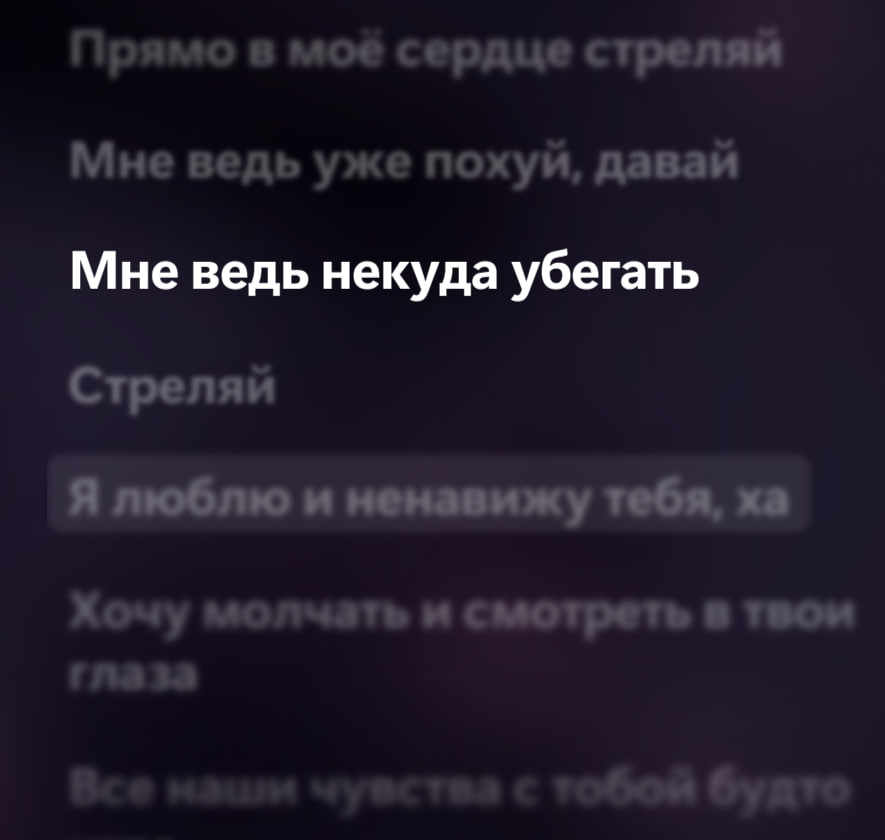

# Glass Lyrics

Расширение для [Spicetify](https://spicetify.app): полноэкранный текст песни в Spotify в стиле Apple Music.



## Возможности

- фон из размытой, медленно переливающейся обложки альбома;
- слева обложка, название, артист, прогресс, кнопки управления и громкость (раскрывается при наведении);
- справа крупный текст: текущая строка держится на трети высоты, остальные приглушены и размыты тем сильнее, чем дальше от неё;
- заливка слов слева направо по ходу строки (примерная: Spotify отдаёт тайминги только по строкам);
- проигрыши показываются тремя «дышащими» точками;
- клик по строке перематывает трек на неё, колесо мыши прокручивает текст вручную;
- клик по названию открывает альбом, по артисту — страницу артиста;
- полноэкранный режим; кнопки окна Spotify прячутся, пока открыт экран текста;
- курсор и кнопки исчезают, если мышь не двигается.

Экран открывается родной кнопкой «Текст» в Spotify или кнопкой Glass Lyrics в плеере снизу. Закрывается клавишей Esc.

Если у Spotify нет текста для трека, расширение ищет его на [lrclib.net](https://lrclib.net). Туда уходят только название трека, исполнитель, альбом и длительность. Отключается в `CONFIG.useLrclibFallback`.

## Установка

Нужен Spotify, скачанный с spotify.com (не из Microsoft Store), и установленный [Spicetify](https://spicetify.app).

### Через Spicetify Marketplace

Открой Marketplace в Spotify, найди **Glass Lyrics** во вкладке Extensions и нажми Install.

### Вручную

Скачай репозиторий и выполни в его папке.

Windows (PowerShell):

```powershell
powershell -ExecutionPolicy Bypass -File .\install.ps1
```

macOS / Linux:

```sh
sh install.sh
```

Или просто положи `src/glass-lyrics.js` в папку `Extensions` Spicetify и выполни:

```sh
spicetify config extensions glass-lyrics.js
spicetify apply
```

## Удаление

```sh
spicetify config extensions glass-lyrics.js-
spicetify apply
```

Вернуть Spotify в исходное состояние: `spicetify restore`.

## Настройки

В начале `src/glass-lyrics.js` есть объект `CONFIG`: высота текущей строки, сила размытия, скорость заливки, порог для точек проигрыша и т. д.

## Разработка

Режим, при котором Spotify перезагружается после каждого сохранения:

```sh
spicetify watch -e
```

## Лицензия

[MIT](LICENSE)
